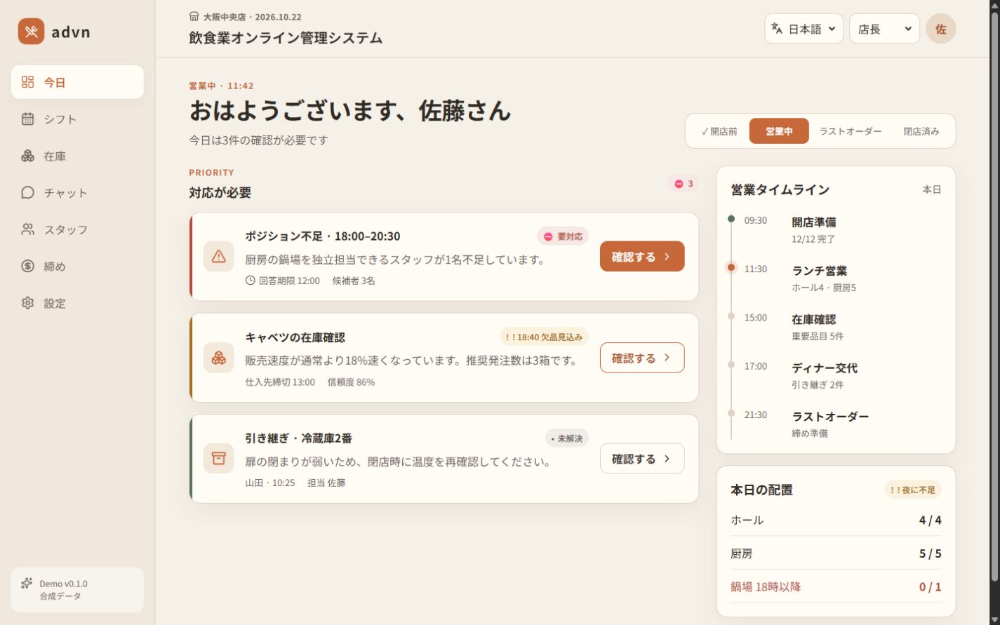
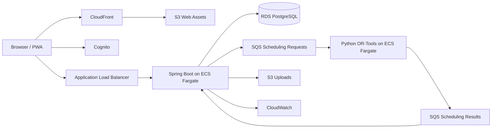

# 飲食業オンライン管理システム

> 店長が入力作業ではなく、今日必要な判断に集中するための飲食店運営SaaS。

`Java / Spring Boot / React / TypeScript / PostgreSQL / Python / OR-Tools / AWS CDK` を使用した、日本の飲食店向けポートフォリオプロジェクトです。公開デモはすべて架空データで動作します。

GitHub: https://github.com/changxu-advanced/restaurant · 当前版本: `v0.2.0`

第二版在首版营业时间线基础上增加了后期扩展模块：客诉与カスタマーハラスメント、预约与无断キャンセル、设备维修、过敏原与特殊饮食、跨店支援和员工评价。它们统一通过“更多”入口进入，移动端保持单列卡片和44px以上操作区域。



## Features

- 営業フェーズと例外を時系列で示す「今日の営業ボード」
- 30分単位の希望提出、ポジション制約、工時警告を含む自動シフト作成
- 欠員支援カード、在庫確認、欠品予測、発注Draft
- 店舗チャット、写真付き引き継ぎ、新人教材
- POS CSV取込、現金実査、売上・粗利・人件費の日次締め
- 日本語、簡体字中国語、英語、色覚サポート

## Architecture



詳細は [docs/architecture/README.md](docs/architecture/README.md) を参照してください。

## Local development

前提: Docker Desktop、Node.js 22、pnpm。

```bash
pnpm install
docker compose up -d db
docker compose up --build api scheduler
pnpm dev
```

Webのみを確認する場合は、APIが未起動でも合成データによるDemo Modeで動作します。

表示言語は日本語、簡体中文、繁體中文、English、한국어、Tiếng Việtに対応しています。言語を切り替えると、ナビゲーション、カード、状態、教材、設定を含む表示中の画面全体が同じ言語に切り替わります。

## Verification

```bash
pnpm typecheck
pnpm test
pnpm build
docker compose run --rm api-test
docker compose run --rm scheduler-test
pnpm infra:synth
```

## Demo boundaries

- 実在する個人・店舗・売上データは使用しません。
- 発注、通知、POS、天気はAdapterの模擬実装です。
- 労務警告は管理支援であり、法律上の判断ではありません。
- 実店舗で使用する前に社労士、セキュリティ担当者による確認が必要です。

## Repository policy

本リポジトリは採用担当者向けに公開するポートフォリオです。ライセンスは付与していません。詳細は [NOTICE](NOTICE) を参照してください。

---

### 中文概要

面向日本餐饮门店的在线管理系统，以减少店长排班、缺员支援、库存确认、交接和日结的操作负担为目标。

### English summary

A portfolio-grade restaurant operations platform for Japan, focused on explainable scheduling, exception-driven workflows, accessible UI, and production-minded AWS architecture.

