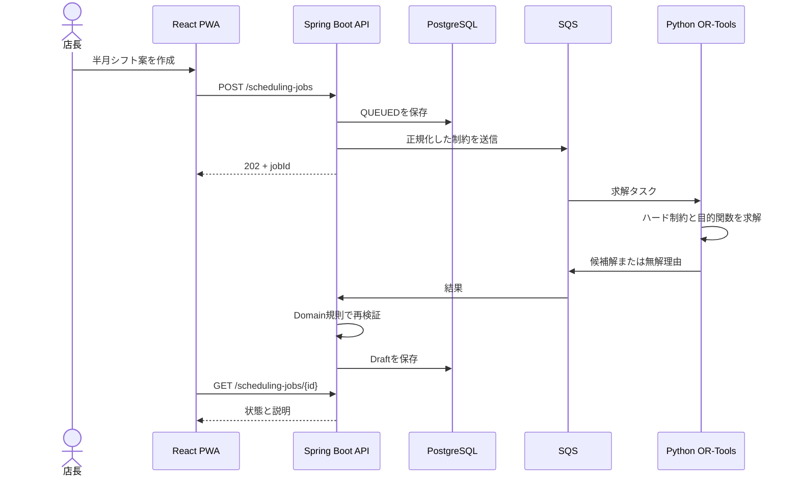

# Architecture

## 方針

Java APIはモジュラーモノリス、制約最適化だけをPythonサービスへ分離する。サービス数を増やすこと自体を目的にせず、トランザクション境界と責務を明確にする。

## Tenant boundary

1. Cognito JWTのcustom claimから`tenant_id`、`store_id`、`role`を得る。
2. Webから任意のtenant IDを受け取らない。
3. Repository queryへ認証コンテキストのtenant/storeを必ず渡す。
4. PostgreSQL RLSを二重防御として使用する。
5. 統合テストで別テナントの読取・更新が失敗することを確認する。

Demo profileは固定の合成テナントを使用し、本番データとの共存を禁止する。
公開Demoでは操作体験を優先し固定テナントを使用する。Cognitoは構築するが、JWT必須化はProduction profileで有効になる。

## Demo and production

| 項目 | Demo | Production reference |
|---|---|---|
| AZ | Single-AZ | Multi-AZ |
| ECS | 最小1 task | 複数task + autoscaling |
| RDS | 小規模、短期backup | Multi-AZ、7日以上backup |
| Network | コスト優先public task | Private subnet + NAT |
| Data | 合成データのみ | 実データ、別AWS account推奨 |

## Failure behavior

- SQSはDLQと3回の再試行を持つ。
- 排班の無解は正常な業務結果として保存する。
- 外部連携失敗時はDraftを保持する。
- 欠損原価を0とせず、日結を暫定にする。
- APIエラーは復旧操作とtrace IDを返す。

